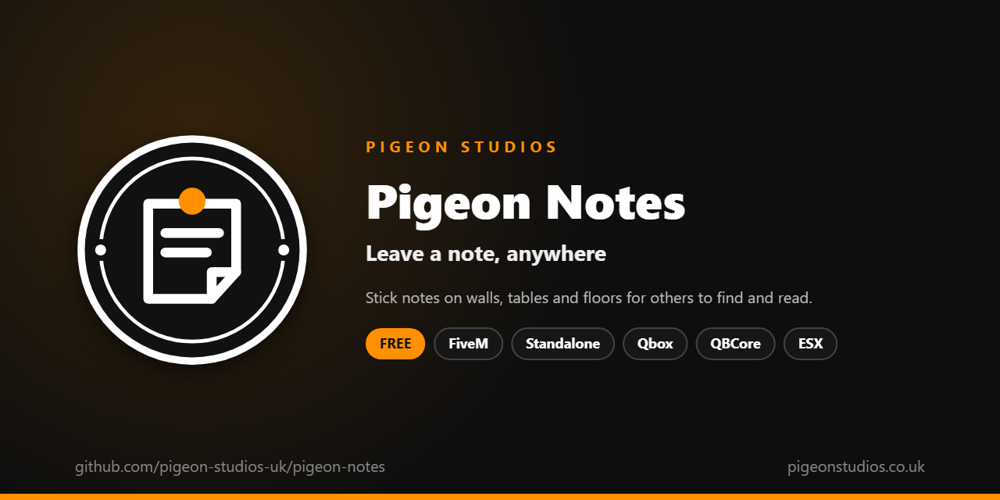

<div align="center">
  

  <h1>Pigeon Notes</h1>

  <p><strong>Write notes and leave them on walls, tables and floors for other players to find and read.</strong></p>

  <p>
    <a href="https://github.com/pigeon-studios-uk/pigeon-notes/releases/latest"></a>
    <a href="LICENSE.md"></a>
    <a href="https://discord.gg/2NFVWEUmDF"></a>
    
  </p>

  <p>
    <a href="https://github.com/pigeon-studios-uk/pigeon-notes/releases/latest"><strong>Download</strong></a> ·
    <a href="#installation">Install</a> ·
    <a href="#configuration">Configure</a> ·
    <a href="CHANGELOG.md">Changelog</a> ·
    <a href="https://discord.gg/2NFVWEUmDF">Support</a>
  </p>
</div>

---

## Contents

- [Overview](#overview)
- [Features](#features)
- [How players use it](#how-players-use-it)
- [Requirements](#requirements)
- [Installation](#installation)
- [Updating](#updating)
- [Configuration](#configuration)
- [As an inventory item](#as-an-inventory-item)
- [Discord](#discord)
- [Exports and events](#exports-and-events)
- [Localisation](#localisation)
- [How it works](#how-it-works)
- [Privacy](#privacy)
- [Update checker](#update-checker)
- [Performance](#performance)
- [Security](#security)
- [Troubleshooting](#troubleshooting)
- [FAQ](#faq)
- [Support](#support)
- [Contributing](#contributing)
- [Licence](#licence)
- [Credits](#credits)

## Overview

Pigeon Notes is a free resource by [Pigeon Studios](https://pigeonstudios.co.uk) for leaving notes in the world. A player writes on paper or a post-it, then sticks it on a wall, leaves it on a table or drops it on the floor. Anyone who walks up to it can read it. Clues, threats, love letters, "back in 5 minutes" signs, a trail for an event: whatever your players come up with.

Notes stay where they're put through restarts, without needing a database, until they expire or someone takes them down. Everything a player writes is checked on the server, with limits so nobody can cover the map, and every note can be logged to Discord for moderation.

## Features

- **Paper or post-it.** A sheet of paper for longer notes, a post-it for short ones. Add your own styles with any prop.
- **Anywhere flat.** Stick notes on walls, leave them on tables, drop them on the floor. A see-through preview shows exactly where it'll go.
- **Signed or not.** Players choose whether to sign. Signed notes show their character's name with Qbox, QBCore or ESX, or their FiveM name.
- **Read it in the world.** Walk up to a note and press E. It opens on screen, in handwriting.
- **Stays put.** Notes survive restarts in the server's own storage. No database needed.
- **Separate worlds.** A note is only seen in the routing bucket it was placed in.
- **Limits.** Length, a cooldown, a limit per player and in total, and how far from the player a note can go, all checked on the server.
- **Tidies itself.** Notes expire after a number of days, or never.
- **Taking down.** The author and staff, staff only, or anyone, as you choose.
- **Moderation.** Every note in the console, and in Discord if you set a webhook.
- **Inventory items.** Open the notepad from a notepad item in ox_inventory, QBCore or ESX.
- **Translatable.** Every message is in `locales/`.
- **Standalone.** No framework or database needed.

## How players use it

**Writing:**

1. Type `/note` (or press the key, if you or the player have set one).
2. Choose paper or post-it, write the note, and tick **Sign it** if they want their name on it.
3. Press **Place it**. A see-through note follows where they look.
4. Look at a wall, table or floor. On a floor, scroll to turn it.
5. Press **E** to place it, or **Backspace** (or **Esc**, or right-click) to put it away.

**Reading:** walk up to a note, within about two metres, and press **E**. The note opens on screen. **Close** or **Esc** closes it. Players who can take it down see **Take it down**.

## Requirements

| Requirement | Version | Notes |
|---|---|---|
| FXServer | A [recommended artifact](https://runtime.fivem.net/artifacts/) | |
| OneSync | Recommended | Lets the server check a note is placed near the player. Without it, everything else is still checked |
| [ox_lib](https://github.com/communityox/ox_lib) | Optional | Used for messages if it's running |
| [Qbox](https://github.com/Qbox-project/qbx_core), [QBCore](https://github.com/qbcore-framework/qb-core) or [ESX Legacy](https://github.com/esx-framework/esx_core) | Optional | Character names on signed notes |

**Frameworks:** none needed. It works the same on standalone servers, ESX Legacy, QBCore, Qbox and ox_core.

## Installation

1. **Download** `pigeon-notes.zip` from the [latest release](https://github.com/pigeon-studios-uk/pigeon-notes/releases/latest). Don't use the green **Code** button; release zips are the tested builds.
2. **Extract** it into your server's `resources` folder. The folder must be called `pigeon-notes`.
3. **Start it** by adding this to `server.cfg`, after your framework if you use one:

   ```cfg
   ensure pigeon-notes
   ```

4. **Let staff take any note down:**

   ```cfg
   add_ace group.admin pigeon-notes.staff allow
   ```

5. **Optional:** a Discord webhook for moderation (see [Discord](#discord)), and a notepad item (see [As an inventory item](#as-an-inventory-item)).
6. **Restart** your server. The console says how many notes were loaded, and shows one line from the update checker:

   ```text
   [Pigeon Notes] 0 notes loaded.
   [Pigeon Studios] Pigeon Notes v1.0.0 is up to date.
   ```

## Updating

1. Read the [changelog](CHANGELOG.md) for every version between yours and the latest, especially any **Upgrade notes**.
2. Back up your `configuration/` and `locales/` folders.
3. Replace the `pigeon-notes` folder with the new release. Notes are kept: they're stored by the server, not in the folder.
4. Copy your settings into the new `configuration/config.lua`. Don't copy the old file over the new one; new versions can add settings.
5. Restart the resource.

## Configuration

All settings are in `configuration/config.lua`, each with a comment explaining it.

| Setting | Default | What it does |
|---|---|---|
| `Config.Locale` | `'en'` | Language file from `locales/` to use |
| `Config.Command` | `'note'` | The command that opens the notepad |
| `Config.Key` | `''` | A key for it. `''` leaves it unbound until a player picks one in GTA's key bindings |
| `Config.Styles` | paper, post-it | What players can write on: `label`, `model` (the prop), `maxLength` (characters) and `colour` (the page when read) |
| `Config.DefaultStyle` | `'paper'` | The style the notepad opens on |
| `Config.AllowSigning` | `true` | Let players sign their notes |
| `Config.PlaceDistance` | `3.0` | How far away, in metres, a note can be placed |
| `Config.Cooldown` | `10` | Seconds between one player's notes |
| `Config.MaxPerPlayer` | `5` | Notes one player can have up at once. `0` for no limit |
| `Config.MaxTotal` | `300` | Notes on the whole server. `0` for no limit |
| `Config.ExpiryDays` | `7` | Days before a note disappears. `0` keeps them until taken down |
| `Config.ReadDistance` | `1.8` | How close, in metres, a player has to be to read a note |
| `Config.DrawDistance` | `40.0` | How far away, in metres, notes are shown |
| `Config.WhoCanRemove` | `'author'` | `'author'` (and staff), `'anyone'` or `'staff'` |
| `Config.StaffPermission` | `'pigeon-notes.staff'` | The ACE permission that can take any note down |
| `Config.ConsoleLog` | `true` | New and removed notes in the server console |

**Adding a style.** Any flat prop that lies face up works. For example, a pink card:

```lua
Config.Styles.card = { label = 'Card', model = 'prop_amanda_note_01b', maxLength = 200, colour = '#f7d6e0' }
```

## As an inventory item

Players can open the notepad by using an item, as well as with `/note`. Make the item in your inventory, then:

**ox_inventory**, in `data/items.lua`:

```lua
['notepad'] = {
    label = 'Notepad',
    weight = 100,
    consume = 0,   -- keep the notepad after writing
    client = { export = 'pigeon-notes.OpenNotepad' },
},
```

**QBCore** (and Qbox's QBCore bridge), in a server file of yours:

```lua
QBCore.Functions.CreateUseableItem('notepad', function(source)
    TriggerClientEvent('pigeon-notes:open', source)
end)
```

**ESX**, in a server file of yours:

```lua
ESX.RegisterUsableItem('notepad', function(source)
    TriggerClientEvent('pigeon-notes:open', source)
end)
```

To open a particular style, pass it: `TriggerClientEvent('pigeon-notes:open', source, 'postit')`. To make the item the only way to write notes, change `Config.Command` to something players won't guess.

## Discord

Every note placed and taken down can be posted to a Discord channel, so staff can see what's being written. Set the webhook in `server.cfg`, never in `config.lua`, which is sent to every player's game:

```cfg
set pigeon_notes_webhook "https://discord.com/api/webhooks/..."
```

Each post has the note's text, who placed it (their FiveM name and server ID), the style, and where it is, with the routing bucket. Mentions in notes never ping anyone. Make the channel visible to staff only.

## Exports and events

```lua
-- Client: open the notepad, on a style from Config.Styles or the default.
exports['pigeon-notes']:OpenNotepad('postit')

-- Server: open it for a player.
TriggerClientEvent('pigeon-notes:open', source, 'paper')

-- Server: every note, as players see them (id, text, style, name if signed, created, position, bucket).
local notes = exports['pigeon-notes']:GetNotes()

-- Server: take a note down. Returns true if there was one.
exports['pigeon-notes']:RemoveNote(id)
```

## Localisation

Change `Config.Locale` to use another language from `locales/`. To add a language, copy `locales/en.lua` to a new file named with the language's two-letter code (for example `de.lua`), change `Locales.en` to match (`Locales.de`) and translate the text in quotes. Keep words in `{curly brackets}` and the `~INPUT_...~` codes as they are. The notepad's own buttons are in the same file. We'd love it if you shared a translation back; see [Contributing](#contributing).

## How it works

**Writing.** The notepad is a page the game shows on top of the screen. When the player places a note, their game works out where they're looking with a ray from the camera, and which way the surface there faces. Facing up is a floor, facing sideways is a wall, and slopes and ceilings are refused. It stands the note up on walls and lays it flat on floors, a few millimetres off the surface.

**Checking.** Their game sends the text, the style and the position to the server, which checks everything again: the style exists, the text isn't empty or too long, the player isn't still in their cooldown, they and the server are under their limits, and, with OneSync, that the note is within `Config.PlaceDistance` of where the server knows the player is. Only then is it saved and sent to every player.

**Storing.** Each note is saved in the server's own key-value storage, which survives restarts and resource updates. Notes past `Config.ExpiryDays` are removed when the resource starts and every hour after.

**Showing.** Every player's game gets the list of notes. Once a second, it makes the notes within `Config.DrawDistance` in the player's routing bucket, and removes ones that are further away. These props exist only in that player's game, so they're not networked entities and cost the server nothing.

**Reading.** Near a note, the player is told they can press E. The server is asked whether they can take it down, so the button only shows for those who can, and the server checks again when they press it.

## Privacy

Notes are stored on your server with the text, the style, where they are, when they were written, the writer's character or FiveM name, and their Rockstar licence identifier, which is how the server knows who wrote which note. The identifier is never sent to other players. Signed notes show the name to whoever reads them; unsigned notes show no name, though staff can see who wrote them in the console and Discord logs. Notes are removed when they expire or are taken down.

## Update checker

When it starts, Pigeon Notes checks our public [version registry](https://github.com/pigeon-studios-uk/pigeon-versions) once and prints one line in the server console saying whether it's up to date. If there's an update, it shows what's new and where to get it. The check is a single request to GitHub and sends nothing about your server or players.

Control it for every Pigeon Studios resource at once in `server.cfg`:

```cfg
set pigeon_update_check "on"      # default: one short line
set pigeon_update_check "quiet"   # only print when there's an update or a problem
set pigeon_update_check "off"     # never check
```

## Performance

In each player's game, nearby notes are made or removed once a second, and whether one is close enough to read is checked a few times a second. While placing a note, it runs every frame, for the preview. On the server, nothing runs between notes, apart from the bucket check every two seconds and the expiry check every hour.

## Security

- Everything a player's game sends is checked on the server: the text and its length, the style, the numbers for the position, how far it is from the player (with OneSync), the cooldown and the limits.
- Taking a note down is checked on the server, by the player's licence identifier and ACE permission. Hiding or showing the button in their game changes nothing.
- Notes are shown on the page as plain text, never as HTML, so nothing written in a note can run.
- The Discord webhook is a server convar, so it's never sent to players. Mentions in notes are switched off in Discord posts.
- The only network request is the update check at start-up, and Discord posts if you set a webhook.

Found a problem? Please don't open a public issue. Use the **Report a vulnerability** button in this repository's **Security** tab, or follow our [Security Policy](https://github.com/pigeon-studios-uk/.github/blob/main/SECURITY.md).

## Troubleshooting

**"Look at a wall, table or floor" and nothing shows.**
The note can't go on slopes, ceilings, vehicles or people, and has to be within `Config.PlaceDistance`. Look straight at a flat surface, closer.

**Notes disappear after a restart.**
Check the console when the resource starts: it says how many notes it loaded. Notes past `Config.ExpiryDays` are removed on start. If you moved the server to a new machine, copy its key-value storage too; notes are stored there.

**"That's too far away" when placing a note right in front of me.**
With OneSync, the server checks the note is near you, with a little room for lag. Raise `Config.PlaceDistance` a little if your players often see this.

**Players can't take down their own notes.**
Check `Config.WhoCanRemove`. With `'staff'`, only staff can. Notes are matched to players by their Rockstar licence, so a note written on one account can't be taken down from another.

**Signed notes show the FiveM name, not the character name.**
Character names come from Qbox, QBCore or ESX, started before this resource. Without a framework, the FiveM name is used.

**The note is hard to read in the world.**
Players read notes on screen with E. The prop in the world shows where it is, not the writing.

## FAQ

**Is it really free?**
Yes. Use it on as many servers as you like, including ones that take donations. You just can't reupload, resell or bundle it. See [Licence](#licence).

**Does it need a database?**
No. Notes are kept in the server's own key-value storage.

**Can notes go on vehicles?**
No. Notes stay where they're put, and vehicles move.

**What happens on FiveM for GTAV Enhanced?**
Enhanced needs the server's key-value storage migrated with Cfx.re's [kvdb-migrator](https://github.com/citizenfx/kvdb-migrator) when you move. Do that and your notes come with you.

## Support

Read [Troubleshooting](#troubleshooting) first, then ask in the support channels of our [Discord](https://discord.gg/2NFVWEUmDF). Please include your Pigeon Notes version, FXServer artifact, framework and any errors from the console (F8 in game). See [Getting help](https://github.com/pigeon-studios-uk/.github/blob/main/SUPPORT.md).

Found a bug? Open a [bug report](https://github.com/pigeon-studios-uk/pigeon-notes/issues/new/choose).

## Contributing

Fixes, improvements, new styles and translations are welcome. Please read the [contributing guide](https://github.com/pigeon-studios-uk/.github/blob/main/CONTRIBUTING.md) first, and open a feature request before working on anything big.

## Licence

Pigeon Notes is free to use under the **[Pigeon Studios Free Licence](LICENSE.md)**.

- ✅ Use it on any number of servers, including monetised ones
- ✅ Change it for your own servers
- ✅ Show it in videos and streams
- ❌ Don't reupload, share or mirror the files; link to this repository instead
- ❌ Don't sell it, bundle it in packs, or put it behind escrow
- ❌ Don't remove the credits

This summary isn't the licence; [LICENSE.md](LICENSE.md) is. Third-party components are listed in [NOTICE.md](NOTICE.md).

## Credits

Made by [Pigeon Studios](https://pigeonstudios.co.uk). Thanks to everyone who has contributed fixes and translations; see the [changelog](CHANGELOG.md).

<sub>Not affiliated with or endorsed by Rockstar Games, Take-Two Interactive or Cfx.re.</sub>
